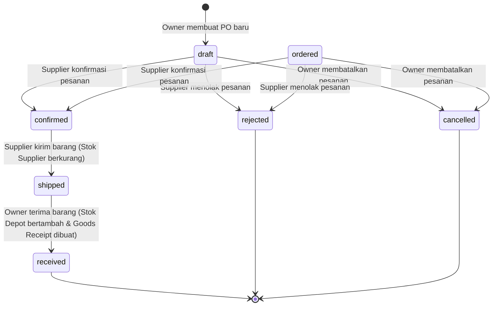

# 📦 Dokumentasi Modul Purchase Order (PO) — Depotify (`project_WRZ`)

Dokumentasi teknis dan fungsional untuk modul **Purchase Order (Pesanan Pembelian)** pada sistem **Depotify (`project_WRZ`)**. Modul ini menangani proses pengadaan barang dari **Owner / Admin Depot** ke **Supplier (`vendor`)**, pelacakan status pengiriman, hingga sinkronisasi stok otomatis antara gudang Supplier dan gudang Depot Owner.

---

## 📋 Daftar Isi

1. [Gambaran Umum & Hak Akses Role](#1-gambaran-umum--hak-akses-role)
2. [Alur Kerja & Transisi Status PO](#2-alur-kerja--transisi-status-po)
3. [Skema Database & Relasi Model](#3-skema-database--relasi-model)
4. [Spesifikasi Endpoint REST API](#4-spesifikasi-endpoint-rest-api)
5. [Logika Bisnis & Sinkronisasi Stok Otomatis](#5-logika-bisnis--sinkronisasi-stok-otomatis)
6. [Struktur File Terkait](#6-struktur-file-terkait)

---

## 1. Gambaran Umum & Hak Akses Role

Modul Purchase Order menghubungkan dua peran utama di dalam sistem:

| Role | Aktor | Hak Akses & Tanggung Jawab pada Modul PO |
| :--- | :--- | :--- |
| **`owner`** | Owner / Admin Depot | • Membuat PO baru ke Supplier (`status: draft`)<br>• Mengubah item PO selama status masih `draft`<br>• Membatalkan PO (`cancelled`) saat status masih `draft` / `ordered`<br>• Menandai barang telah diterima (`received`) saat status `shipped`<br>• Menghapus PO yang masih berstatus `draft` |
| **`vendor`** | Supplier | • Melihat daftar & detail PO yang ditujukan khusus untuk profil vendor miliknya<br>• Mengonfirmasi pesanan (`confirmed`) atau menolak pesanan (`rejected`) dari status `draft` / `ordered`<br>• Menandai pesanan yang sudah `confirmed` menjadi dikirim (`shipped`) |

> **Catatan Isolasi Data:** Supplier (`role: vendor`) hanya dapat melihat dan memperbarui PO yang memiliki `vendor_id` milik akunnya sendiri. Percobaan akses ke PO milik supplier lain akan menghasilkan HTTP `403 Forbidden` (`FORBIDDEN_PO_ACCESS`).

---

## 2. Alur Kerja & Transisi Status PO

### 2.1 Diagram Alur Status (State Machine)



### 2.2 Daftar Status & Label UI

| Status Database | Label UI (Admin / Supplier) | Deskripsi |
| :--- | :--- | :--- |
| `draft` | **Pending / Menunggu Konfirmasi** | Status awal saat PO baru dibuat oleh Owner. Item masih dapat diedit atau dihapus. |
| `ordered` | **Pending / Menunggu Konfirmasi** | Pesanan telah diajukan ke Supplier dan menunggu respons. |
| `confirmed` | **Diproses** | Supplier menyetujui PO dan sedang menyiapkan barang. |
| `shipped` | **Dikirim Supplier** | Barang telah dikirim oleh Supplier; stok gudang Supplier otomatis dipotong. |
| `received` | **Selesai (Diterima)** | Barang telah diterima oleh Owner; stok gudang Depot otomatis bertambah & tercatat di `goods_receipts`. |
| `rejected` | **Ditolak Supplier** | Pesanan ditolak oleh Supplier. |
| `cancelled` | **Batal** | Pesanan dibatalkan oleh Owner sebelum diproses Supplier. |

### 2.3 Aturan Transisi Berdasarkan Role

- **Transisi yang Diizinkan untuk Owner (`OWNER_TRANSITIONS`)**:
  - `draft` -> `cancelled`
  - `ordered` -> `cancelled`
  - `shipped` -> `received`
- **Transisi yang Diizinkan untuk Supplier (`VENDOR_TRANSITIONS`)**:
  - `draft` -> `confirmed`, `rejected`
  - `ordered` -> `confirmed`, `rejected`
  - `confirmed` -> `shipped`

---

## 3. Skema Database & Relasi Model

### 3.1 Tabel `purchase_orders`
Model: `App\Models\PurchaseOrder`

| Kolom | Tipe Data | Keterangan |
| :--- | :--- | :--- |
| `id` | `bigint (PK)` | Primary Key |
| `po_number` | `varchar(30), unique` | Nomor PO otomatis dengan format `PO-YYYYMMDD-XXXX` (contoh: `PO-20261111-0001`) |
| `po_date` | `date` | Tanggal pembuatan PO |
| `vendor_id` | `foreignId` | Relasi ke tabel `vendor(id)` (`restrictOnDelete`) |
| `created_by` | `foreignId` | Relasi ke tabel `users(id)` pembuat PO (`restrictOnDelete`) |
| `payment_method` | `varchar(20)` | Metode pembayaran: `cash`, `transfer`, `qris`, `credit` (default: `cash`) |
| `expected_delivery_date` | `date, nullable` | Estimasi tanggal pengiriman |
| `shipping_address` | `varchar(255), nullable` | Alamat pengiriman tujuan depot |
| `shipping_method` | `varchar(50), nullable` | Metode pengiriman |
| `subtotal_price` | `decimal(14,2)` | Subtotal harga seluruh item |
| `tax` | `decimal(14,2)` | Pajak (default: `0`) |
| `total_price` | `decimal(14,2)` | Total nilai PO |
| `status` | `enum` | `draft`, `ordered`, `confirmed`, `shipped`, `received`, `rejected`, `cancelled` |
| `notes` | `text, nullable` | Catatan tambahan dari Owner atau Supplier |
| `created_at` / `updated_at` | `timestamp` | Waktu pembuatan & pembaruan data |

### 3.2 Tabel `purchase_order_items`
Model: `App\Models\PurchaseOrderItem`

| Kolom | Tipe Data | Keterangan |
| :--- | :--- | :--- |
| `id` | `bigint (PK)` | Primary Key |
| `purchase_order_id` | `foreignId` | Relasi ke `purchase_orders(id)` (`cascadeOnDelete`) |
| `product_id` | `foreignId` | Relasi ke `products(id)` (`restrictOnDelete`) |
| `product_name` | `varchar(150)` | Snapshot nama produk beserta variannya saat PO dibuat |
| `product_description` | `text, nullable` | Deskripsi / varian item |
| `qty_ordered` | `integer` | Jumlah kuantitas barang yang dipesan (minimal `1`) |
| `agreed_price` | `decimal(12,2)` | Harga satuan yang disepakati (diambil dari harga produk supplier) |
| `total_price` | `decimal(14,2)` | Total harga baris item (`qty_ordered * agreed_price`) |
| `qty_empty_container_received` | `integer` | Jumlah wadah kosong terkait (default: `0`) |

### 3.3 Tabel `goods_receipts` & `goods_receipt_items`
Model: `App\Models\GoodsReceipt` & `App\Models\GoodsReceiptItem`

Dibuat secara otomatis ketika Owner mengubah status PO menjadi `received`:
- `receipt_number`: Format otomatis `GR-YYYYMMDD-XXXX`
- `qc_status`: Otomatis tercatat `passed`
- `document_type`: `do_and_invoice` dengan `document_number` berisi `po_number`
- `goods_receipt_items`: Mencatat `qty_diterima`, `qty_ditolak = 0`, dan `product_id` milik Depot Owner.

---

## 4. Spesifikasi Endpoint REST API

Seluruh endpoint berada di bawah prefix `/api/v1` dan wajib menyertakan header autentikasi Sanctum:
```http
Accept: application/json
Content-Type: application/json
Authorization: Bearer <token>
```

### 4.1 Ringkasan Endpoint

| Method | Endpoint | Role yang Diizinkan | Deskripsi |
| :--- | :--- | :--- | :--- |
| `GET` | `/api/v1/purchase-orders` | `owner`, `vendor` | Mengambil daftar PO (dengan paginasi, pencarian, dan filter status). |
| `GET` | `/api/v1/purchase-orders/{id}` | `owner`, `vendor` | Mengambil detail lengkap 1 PO beserta `vendor`, `creator`, `items`, dan `goodsReceipts`. |
| `POST` | `/api/v1/purchase-orders` | `owner` | Membuat Purchase Order baru ke Supplier. |
| `PUT` | `/api/v1/purchase-orders/{id}` | `owner`, `vendor` | Memperbarui data PO (Owner) atau mengubah status PO (Owner / Supplier). |
| `DELETE` | `/api/v1/purchase-orders/{id}` | `owner` | Menghapus PO (hanya berlaku jika status masih `draft`). |

---

### 4.2 Detail Endpoint & Contoh Payload

#### A. Daftar Purchase Order (`GET /api/v1/purchase-orders`)
**Query Parameters (Opsional):**
- `page` *(int)*: Nomor halaman paginasi.
- `per_page` *(int)*: Jumlah data per halaman (default: `15`, maks: `50`).
- `vendor_id` *(int)*: Filter berdasarkan ID supplier (khusus `owner`; untuk `vendor` otomatis difilter ke akunnya).
- `search` *(string)*: Pencarian berdasarkan `po_number`, `notes`, `shipping_address`, nama pembuat (`creator.name`), atau nama produk (`items.product_name`).
- `status` *(string)*: Mendukung filter status spesifik (`draft`, `ordered`, `confirmed`, `shipped`, `received`, `rejected`, `cancelled`) maupun alias grup:
  - `pending` / `menunggu` -> `['draft', 'ordered']`
  - `processing` / `diproses` -> `['confirmed', 'shipped']`
  - `completed` / `selesai` -> `'received'`
  - `cancelled_group` / `dibatalkan` -> `['rejected', 'cancelled']`
  - `history` / `riwayat` -> `['shipped', 'received', 'rejected', 'cancelled']`

---

#### B. Buat Purchase Order Baru (`POST /api/v1/purchase-orders`) — *Khusus Owner*

**Aturan Validasi:**
- `vendor_id`: `required|exists:vendor,id`
- `payment_method`: `required|in:cash,transfer,qris,credit`
- `shipping_address`: `nullable|string|max:255`
- `notes`: `nullable|string`
- `items`: `required|array|min:1`
- `items.*.product_id`: `required|exists:products,id` (Produk harus milik Supplier yang dipilih)
- `items.*.qty_ordered`: `required|integer|min:1`
- `items.*.product_description`: `nullable|string`

**Contoh Request Body:**
```json
{
  "vendor_id": 1,
  "payment_method": "transfer",
  "shipping_address": "Depot Air Minum Segar Jaya, Jl. Merdeka No. 10",
  "notes": "Mohon dikirim sebelum jam 15.00 WIB",
  "items": [
    {
      "product_id": 5,
      "qty_ordered": 20,
      "product_description": "Galon 19L"
    }
  ]
}
```

**Contoh Response (`201 Created`):**
```json
{
  "id": 12,
  "po_number": "PO-20261111-0001",
  "po_date": "2026-11-11T00:00:00.000000Z",
  "vendor_id": 1,
  "created_by": 1,
  "payment_method": "transfer",
  "shipping_address": "Depot Air Minum Segar Jaya, Jl. Merdeka No. 10",
  "subtotal_price": "300000.00",
  "total_price": "300000.00",
  "status": "draft",
  "notes": "Mohon dikirim sebelum jam 15.00 WIB",
  "vendor": {
    "id": 1,
    "name": "PT Tirta Supplier Utama"
  },
  "creator": {
    "id": 1,
    "name": "Owner Depot",
    "email": "owner@depotify.com",
    "phone": "08123456789"
  },
  "items": [
    {
      "id": 18,
      "purchase_order_id": 12,
      "product_id": 5,
      "product_name": "Air Mineral Galon (19L)",
      "product_description": "Galon 19L",
      "qty_ordered": 20,
      "agreed_price": "15000.00",
      "total_price": "300000.00"
    }
  ]
}
```

---

#### C. Update Status oleh Supplier (`PUT /api/v1/purchase-orders/{id}`) — *Role: Vendor*

**Contoh Request Body (Konfirmasi / Kirim / Tolak):**
```json
{
  "status": "shipped",
  "notes": "Barang sudah dikirim dengan armada truk B 1234 XYZ."
}
```

---

#### D. Terima Barang / Batalkan PO oleh Owner (`PUT /api/v1/purchase-orders/{id}`) — *Role: Owner*

**Contoh Request Body (Konfirmasi Barang Diterima di Depot):**
```json
{
  "status": "received"
}
```

---

#### E. Hapus Purchase Order (`DELETE /api/v1/purchase-orders/{id}`) — *Khusus Owner*
- Hanya PO dengan status `draft` yang dapat dihapus secara permanen (`200 OK`).
- Jika status bukan `draft`, server mengembalikan HTTP `409 Conflict`:
  ```json
  {
    "message": "Hanya PO berstatus draft yang bisa dihapus. Gunakan status cancelled."
  }
  ```

---

## 5. Logika Bisnis & Sinkronisasi Stok Otomatis

Di dalam `PurchaseOrderController`, terdapat mekanisme transaksi database (`DB::transaction`) dan penguncian baris (`lockForUpdate()`) untuk menjamin konsistensi stok antara Supplier dan Owner:

1. **Penentuan Harga Satuan (`agreed_price`)**:
   - Saat item disimpan (`saveItems`), sistem memvalidasi bahwa setiap `product_id` benar-benar milik `vendor_id` yang dipilih.
   - Harga satuan diambil otomatis dari `selling_price` produk milik Supplier (atau fallback ke `purchase_price` untuk produk lama).
2. **Pemotongan Stok Gudang Supplier Saat Dikirim (`deductSupplierStockOnShip`)**:
   - Dipicu ketika status PO berubah menjadi `shipped`.
   - Bersifat **idempoten** (mengecek tabel `stock_movements` dengan `reference_type = 'po_supplier_out'` dan `reference_id = $po->id` agar stok tidak pernah terpotong dua kali).
   - Memvalidasi ketersediaan `stock_content` produk Supplier. Jika stok gudang Supplier kurang dari `qty_ordered`, transaksi dibatalkan dengan pesan error validasi `422`.
   - Mengurangi `stock_content` produk Supplier dan mencatat histori di `stock_movements` (`movement_type = 'out'`, `stock_type = 'fill'`).
3. **Penambahan Stok Gudang Depot Owner Saat Diterima (`receiveOrderItemsIntoStock`)**:
   - Dipicu ketika Owner mengubah status PO dari `shipped` menjadi `received`.
   - Membuat dokumen **`GoodsReceipt`** (`GR-YYYYMMDD-XXXX`) dan rincian **`GoodsReceiptItem`**.
   - **Sinkronisasi Katalog Otomatis (`resolveOwnerDepotProduct`)**:
     - Mencari produk padanan di gudang Depot Owner (`vendor_id = null`) berdasarkan `source_product_id` atau kecocokan `name` + `variant`.
     - Jika produk belum ada di katalog Depot Owner, sistem otomatis membuatkan kategori (jika belum ada) dan produk baru di gudang Depot Owner dengan SKU berawalan `DPT-`.
   - Menambahkan `stock_content` pada produk Depot Owner, memperbarui `purchase_price` sesuai `agreed_price` PO, serta mencatat histori `stock_movements` (`movement_type = 'in'`, `reference_type = 'goods_receipt'`).
4. **Audit Trail (`ActivityLogger`)**:
   - Setiap pembuatan PO dan perubahan status PO oleh Owner maupun Supplier otomatis dicatat ke tabel `activity_logs`.

---

## 6. Struktur File Terkait

| Komponen | Lokasi File | Peran |
| :--- | :--- | :--- |
| **Controller** | `app/Http/Controllers/PurchaseOrderController.php` | Logika CRUD PO, validasi transisi status, pemotongan stok supplier, dan penerimaan stok depot. |
| **Models** | • `app/Models/PurchaseOrder.php`<br>• `app/Models/PurchaseOrderItem.php`<br>• `app/Models/GoodsReceipt.php`<br>• `app/Models/GoodsReceiptItem.php` | Representasi Eloquent ORM untuk PO, item PO, dan dokumen penerimaan barang. |
| **Routes** | `routes/api.php` | Definisi rute `/api/v1/purchase-orders` dengan middleware `role:owner,vendor` dan `role:owner`. |
| **Migrations** | • `database/migrations/2026_09_13_052142_create_purchase_orders_table.php`<br>• `database/migrations/2026_09_13_052148_create_purchase_order_items_table.php`<br>• `database/migrations/2026_09_13_052151_create_goods_receipts_table.php`<br>• `database/migrations/2026_09_13_052156_create_goods_receipt_items_table.php`<br>• `database/migrations/2026_10_19_053536_add_payment_method_to_purchase_orders_table.php` | Skema tabel database untuk PO dan penerimaan barang. |
| **Frontend (Owner/Admin)** | `resources/js/admin/purchase.jsx` | Antarmuka halaman manajemen PO untuk Owner/Admin Depot (buat PO, filter, batalkan, terima barang). |
| **Frontend (Supplier)** | • `resources/js/vendor/orders.jsx`<br>• `resources/js/vendor/order-detail-modal.jsx`<br>• `resources/js/vendor/history.jsx` | Antarmuka halaman daftar pesanan masuk, modal konfirmasi/pengiriman/penolakan, dan riwayat PO untuk Supplier. |
