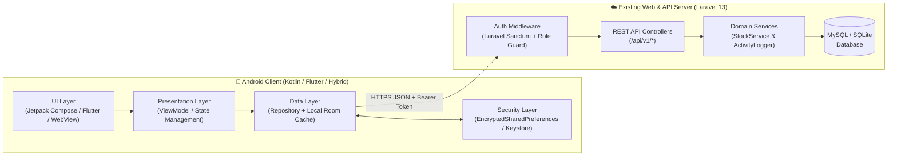

# 📱 Depotify (Project WRZ) — Android Application Development Guide


A comprehensive technical specification and implementation guide for the **Android Development Team** to build, integrate, and deploy the mobile application for the **Depotify Web-Based Sales & Inventory Management System (`project_WRZ`)**.

---

## 📋 Table of Contents

1. [Project Overview & Objectives](#1-project-overview--objectives)
2. [System Architecture & Tech Stack](#2-system-architecture--tech-stack)
3. [Core Features & Modules (Sales System)](#3-core-features--modules-sales-system)
4. [API & Endpoint Requirements](#4-api--endpoint-requirements)
5. [UI/UX & Design Guidelines](#5-uiux--design-guidelines)
6. [Security & Data Storage](#6-security--data-storage)
7. [Development Roadmap & Milestones](#7-development-roadmap--milestones)
8. [Local Backend Setup for Android Testing](#8-local-backend-setup-for-android-testing)

---

## 1. Project Overview & Objectives

### 1.1 Background
**Depotify (`project_WRZ`)** is an integrated web-based sales, distribution, and inventory management platform built on **Laravel 13**, **Laravel Sanctum**, and **React (Inertia.js)**. It manages end-to-end operations across three primary user roles:
- **Customer (`customer`)**: Browses products, places refill/new-container/direct-purchase orders, selects payment methods, and tracks order fulfillment.
- **Owner / Admin (`owner`)**: Manages point-of-sale (POS) transactions, product catalogs, depot stock (filled & empty containers), supplier purchase orders (PO), financial reports, and user activity logs.
- **Supplier / Vendor (`vendor`)**: Manages supplier product catalogs, warehouse inventory, and processes incoming purchase orders from the depot owner.

### 1.2 Objectives of the Android Initiative
Migrating and extending the existing web sales system to the **Android platform** aims to achieve the following goals:
1. **Mobile-First Accessibility**: Enable customers to place orders anytime and enable owners/cashiers and suppliers to manage daily sales and stock movements on the go.
2. **Real-Time Operational Synchronization**: Connect directly to the existing `/api/v1` RESTful backend so orders, stock deductions, container exchanges, and financial records remain unified across Web and Android.
3. **Faster Checkout & Field Operations**: Provide native mobile capabilities (push notifications, camera/barcode scanning for SKUs, one-tap WhatsApp/receipt sharing, and offline-resilient cart state).
4. **Multi-Role Unified Experience**: Support role-based navigation and permissions (`customer`, `owner`, `vendor`) from a single authentication gateway.

---

## 2. System Architecture & Tech Stack

### 2.1 Recommended Implementation Approaches
The existing backend already exposes a complete, token-authenticated REST API (`/api/v1/*`) alongside its responsive web interface. The Android team may adopt one of the following architectures depending on timeline and resource allocation:

| Approach | Stack Recommendation | When to Use | Pros & Cons |
| :--- | :--- | :--- | :--- |
| **Option A: Native Android (Recommended)** | **Kotlin**, **Jetpack Compose**, **MVVM / Clean Architecture**, **Retrofit2 + OkHttp3**, **Coroutines + StateFlow**, **Room**, **Hilt** | Full production release with best performance, smooth animations, and hardware integration. | **Pros**: Best UX, full offline cart/caching, native security.<br>**Cons**: Longer initial UI development time. |
| **Option B: Cross-Platform Native** | **Flutter (Dart)** with **Dio**, **Riverpod / Bloc**, **Flutter Secure Storage**, **GoRouter** | Rapid development with near-native performance and future iOS expansion. | **Pros**: Single codebase, fast UI iteration.<br>**Cons**: Slightly larger APK/AAB size. |
| **Option C: Hybrid / Smart WebView Wrapper** | **Kotlin + Android `WebView`** with **JS Bridge (`@JavascriptInterface`)**, custom offline fallback screen, and native push notifications | Immediate MVP rollout reusing the existing responsive web frontend. | **Pros**: Fastest time-to-market.<br>**Cons**: Dependent on network latency for page rendering; limited offline capability. |

### 2.2 High-Level Architecture Diagram



### 2.3 Backend Connection Specifications
- **Base API Prefix**: `https://<your-domain>/api/v1` (or `http://10.0.2.2:8000/api/v1` on Android Emulator)
- **Data Format**: `application/json` (`Accept: application/json`, `Content-Type: application/json`)
- **Authentication Mechanism**: `Bearer <token>` via **Laravel Sanctum** (24-hour token expiration)
- **Health Check Endpoint**: `GET /api/v1/health` (No authentication required; use for connectivity & server status checks)

---

## 3. Core Features & Modules (Sales System)

### 3.1 Authentication & User Management
- **Unified Login (`POST /api/v1/auth/login`)**: Single login screen for all roles (`customer`, `owner`, `vendor`). Upon login, the app inspects `data.user.role` and routes the user to the corresponding role workspace.
- **Customer Self-Registration (`POST /api/v1/auth/register`)**: Public registration form (Name, Email, Phone, Address, Password + Confirmation) that automatically assigns the `customer` role and returns an active Bearer token.
- **Session & Profile Management**:
  - Fetch current authenticated user & hydrated profile relations (`GET /api/v1/auth/me`).
  - Update customer profile (`PUT /api/v1/customer/profile`) or supplier profile (`PUT /api/v1/supplier/profile`).
  - Secure logout & server-side token revocation (`POST /api/v1/auth/logout`).

### 3.2 Product Catalog & Search
- **Catalog Browsing**: Display available products with SKU, name, category badge, variant, unit, selling price, container deposit price (`deposit_price`), and live available stock (`stock_content`).
- **Search & Filtering**:
  - Search by product name or SKU (`?search=`).
  - Filter by category (`?category_id=`) and low-stock alert status (`?low_stock=1`).
- **Container & Refill Business Logic**:
  - Products with `uses_container = true` (e.g., 19L Water Gallon, LPG Cylinder) support three transaction types:
    - `top_up`: Refill / exchange with an empty container (`empty_container_accepted` returned by customer).
    - `new_deposit`: Purchase content + new container deposit (`selling_price + deposit_price`).
    - `buy_disconnect`: Direct purchase without container deposit.
  - Products with `uses_container = false` default automatically to `buy_disconnect`.

### 3.3 Shopping Cart & Checkout Process
- **Local Persistent Cart**: Maintain cart items locally (via Room / DataStore) so users do not lose selections if the app closes.
- **Dynamic Price Calculation**:
  - $\text{Product Subtotal} = \text{qty} \times \text{selling\_price}$
  - $\text{Deposit Subtotal} = \text{qty} \times \text{deposit\_price}$ (applicable when `transaction_type == "new_deposit"`)
  - $\text{Item Subtotal} = \text{Product Subtotal} + \text{Deposit Subtotal}$
- **Checkout Validation**:
  - Verify requested `qty <= stock_content` before submission.
  - Capture or confirm delivery details (`customer_phone`, `customer_address`).
  - Submit order via `POST /api/v1/customer/orders` (for Customer) or `POST /api/v1/sales` (for Owner/POS cashier).

### 3.4 Payment Gateway Integration & Payment Methods
- **Supported Payment Methods (`payment_method`)**:
  - `cash`: Cash on Delivery (COD) / In-store cash payment.
  - `transfer`: Bank Transfer / Virtual Account / QRIS verification.
  - `other`: E-Wallet or custom payment channel.
- **Sales Channels (`channel`)**:
  - Automatically tagged as `app` for customer mobile orders, `walk_in` for POS counter transactions, or `whatsapp` for assisted orders.
- **Payment Gateway Extensibility (Midtrans / Xendit Ready)**:
  - Designed to support Snap Token / QRIS deep-link callbacks while preserving the backend `payment_method` and transaction status lifecycle.

### 3.5 Transaction History & Order Tracking
- **Order Status Lifecycle**:
  - `pending` / `processing`: Order received and being prepared/delivered.
  - `completed`: Order fulfilled and payment settled.
  - `cancelled`: Order cancelled (stock movements are automatically reversed and returned to inventory by the backend `StockService`).
- **Customer Order Tracking**:
  - View summary cards (Total Orders, Processing, Completed, Cancelled).
  - Filter order history by `status` and search by `transaction_code` (e.g., `TRX-...`).
  - View detailed itemized digital receipt (`GET /api/v1/customer/orders/{id}`).

### 3.6 Stock, Inventory & Supplier Management (Admin / Owner & Vendor)
- **Inventory Monitoring (`GET /api/v1/stock`)**:
  - Track **Filled Stock (`stock_content` / `isi`)** and **Empty Container Stock (`stock_empty` / `kosong`)**.
  - View stock movement history (`masuk`, `keluar`, `penyesuaian`) and perform manual stock adjustments (`PUT /api/v1/stock/{id}`).
- **Purchase Orders (`purchase-orders`)**:
  - Owner creates POs to suppliers (`POST /api/v1/purchase-orders`).
  - Supplier and Owner track and update PO fulfillment status (`GET` / `PUT /api/v1/purchase-orders/{id}`).
- **Reports & Audit Logs (`owner`)**:
  - Financial & sales analytics (`GET /api/v1/reports`) and security/activity audit trail (`GET /api/v1/activity-logs`).

---

## 4. API & Endpoint Requirements

### 4.1 Required HTTP Headers
All requests to `/api/v1/*` must include:
```http
Accept: application/json
Content-Type: application/json
Authorization: Bearer <plainTextToken>   # Required for all protected routes
```

### 4.2 Complete Endpoint Reference

#### A. System & Authentication
| Method | Endpoint | Auth / Role | Description |
| :--- | :--- | :--- | :--- |
| `GET` | `/api/v1/health` | Public | Check backend server connectivity and status. |
| `POST` | `/api/v1/auth/login` | Public | Authenticate user (`owner`, `vendor`, `customer`) and issue Bearer token. |
| `POST` | `/api/v1/auth/register` | Public | Register a new `customer` account and return Bearer token. |
| `GET` | `/api/v1/auth/me` | `auth:sanctum` | Retrieve current logged-in user details and profile relations. |
| `POST` | `/api/v1/auth/logout` | `auth:sanctum` | Revoke active access tokens and log out. |

#### B. Customer Module (`role:customer`)
| Method | Endpoint | Auth / Role | Description |
| :--- | :--- | :--- | :--- |
| `GET` | `/api/v1/customer/dashboard` | `customer` | Fetch customer dashboard metrics, active catalog, and recent orders. |
| `PUT` | `/api/v1/customer/profile` | `customer` | Update customer name, phone, address, or password. |
| `GET` | `/api/v1/customer/orders` | `customer` | List customer's orders with summary counts and pagination. |
| `GET` | `/api/v1/customer/orders/{id}` | `customer` | View detailed order receipt and item breakdown. |
| `POST` | `/api/v1/customer/orders` | `customer` | Submit a new customer checkout order. |
| `PUT` | `/api/v1/customer/orders/{id}` | `customer` | Update or cancel an existing order (subject to status rules). |

#### C. Catalog, Stock & Procurement (`role:owner,vendor`)
| Method | Endpoint | Auth / Role | Description |
| :--- | :--- | :--- | :--- |
| `GET` | `/api/v1/categories` | `owner`, `vendor` | List product categories. |
| `POST` | `/api/v1/categories` | `owner`, `vendor` | Create a new product category. |
| `PUT` | `/api/v1/categories/{id}` | `owner`, `vendor` | Update a category. |
| `DELETE` | `/api/v1/categories/{id}` | `owner`, `vendor` | Delete a category. |
| `GET` | `/api/v1/products` | `owner`, `vendor` | List products (`?search=`, `?category_id=`, `?low_stock=1`, `?vendor_id=`). |
| `GET` | `/api/v1/products/{id}` | `owner`, `vendor` | View single product details. |
| `POST` | `/api/v1/products` | `owner`, `vendor` | Create a new product. |
| `PUT` | `/api/v1/products/{id}` | `owner`, `vendor` | Update product details and pricing. |
| `DELETE` | `/api/v1/products/{id}` | `owner`, `vendor` | Delete a product. |
| `GET` | `/api/v1/stock` | `owner`, `vendor` | List stock levels (`stock_content`, `stock_empty`) and movements. |
| `GET` | `/api/v1/stock/{id}` | `owner`, `vendor` | View detailed stock history for a specific product. |
| `PUT` | `/api/v1/stock/{id}` | `owner`, `vendor` | Adjust product filled/empty stock quantities. |
| `GET` | `/api/v1/purchase-orders` | `owner`, `vendor` | List purchase orders between depot and supplier. |
| `GET` | `/api/v1/purchase-orders/{id}` | `owner`, `vendor` | View purchase order details. |
| `PUT` | `/api/v1/purchase-orders/{id}` | `owner`, `vendor` | Update purchase order status / fulfillment. |

#### D. Owner / Admin POS & Management (`role:owner`)
| Method | Endpoint | Auth / Role | Description |
| :--- | :--- | :--- | :--- |
| `GET` | `/api/v1/dashboard` | `owner` | Fetch executive KPI dashboard (revenue, low stock, recent sales). |
| `GET` | `/api/v1/sales` | `owner` | List all customer sales transactions (`?status=`, `?payment_method=`, `?search=`). |
| `GET` | `/api/v1/sales/{id}` | `owner` | View specific sales transaction detail. |
| `POST` | `/api/v1/sales` | `owner` | Create POS / walk-in / WhatsApp sales transaction. |
| `PUT` | `/api/v1/sales/{id}` | `owner` | Update transaction status (`processing`, `completed`, `cancelled`). |
| `DELETE` | `/api/v1/sales/{id}` | `owner` | Delete a sales transaction and restore stock. |
| `POST` | `/api/v1/purchase-orders` | `owner` | Create a new Purchase Order to a supplier. |
| `DELETE` | `/api/v1/purchase-orders/{id}` | `owner` | Delete a Purchase Order. |
| `GET` | `/api/v1/vendors` | `owner` | List registered suppliers/vendors (`POST`, `PUT`, `DELETE` also supported). |
| `GET` | `/api/v1/reports` | `owner` | Retrieve financial and sales reports. |
| `GET` | `/api/v1/activity-logs` | `owner` | View user and system audit trail logs. |

#### E. Supplier Module (`role:vendor`)
| Method | Endpoint | Auth / Role | Description |
| :--- | :--- | :--- | :--- |
| `GET` | `/api/v1/supplier/dashboard` | `vendor` | Retrieve supplier KPI dashboard and incoming PO summary. |
| `GET` | `/api/v1/supplier/profile` | `vendor` | View supplier company profile. |
| `PUT` | `/api/v1/supplier/profile` | `vendor` | Update supplier company profile. |

---

### 4.3 Key JSON Payload Examples

#### 1. Login Request & Response (`POST /api/v1/auth/login`)
**Request:**
```json
{
  "email": "customer@example.com",
  "password": "password123"
}
```
**Response (`200 OK`):**
```json
{
  "success": true,
  "message": "Login berhasil.",
  "data": {
    "user": {
      "id": 3,
      "name": "Budi Santoso",
      "email": "customer@example.com",
      "phone": "081234567890",
      "role": "customer",
      "is_active": true,
      "customer": {
        "id": 1,
        "user_id": 3,
        "name": "Budi Santoso",
        "phone": "081234567890",
        "address": "Jl. Merdeka No. 10, Jakarta"
      }
    },
    "token": "1|abcdef1234567890plainTextSanctumToken...",
    "token_type": "Bearer",
    "expires_at": "2026-11-08T18:20:00+07:00",
    "expires_in_seconds": 86400
  }
}
```

#### 2. Create Order / Checkout Request (`POST /api/v1/customer/orders` or `POST /api/v1/sales`)
**Request:**
```json
{
  "customer_phone": "081234567890",
  "customer_address": "Jl. Merdeka No. 10, Jakarta",
  "channel": "app",
  "payment_method": "transfer",
  "items": [
    {
      "product_id": 1,
      "transaction_type": "top_up",
      "qty": 2,
      "empty_container_accepted": 2
    },
    {
      "product_id": 2,
      "transaction_type": "new_deposit",
      "qty": 1,
      "empty_container_accepted": 0
    }
  ]
}
```

---

## 5. UI/UX & Design Guidelines

### 5.1 Design System & Visual Identity
- **Design Language**: **Material Design 3 (Material You)** with clean cards, clear typography hierarchy, and high-contrast status badges.
- **Color Palette**:
  - **Primary**: Deep Ocean / Water Blue (`#0284C7` / `#0369A1`) — reflecting clean water & depot reliability.
  - **Secondary / Accent**: Teal / Cyan (`#0D9488`).
  - **Semantic Status Colors**:
    - `completed` / Active / In-Stock: Emerald Green (`#16A34A`)
    - `processing` / `pending` / Low-Stock Warning: Amber (`#D97706`)
    - `cancelled` / Out-of-Stock / Error: Rose Red (`#DC2626`)
- **Typography**: `Inter`, `Plus Jakarta Sans`, or `Roboto` with minimum `14sp` body text and `16sp` form inputs to prevent zoom/readability issues.

### 5.2 Navigation Architecture
1. **Role-Adaptive Bottom Navigation Bar** (4–5 top-level destinations max):
   - **Customer Role**: `Home / Catalog` • `Cart` • `My Orders` • `Profile`
   - **Owner / Admin Role**: `Dashboard` • `POS / Sales` • `Products & Stock` • `Purchase Orders` • `More (Reports/Logs)`
   - **Supplier Role**: `Dashboard` • `My Catalog` • `Warehouse Stock` • `Incoming PO` • `Profile`
2. **Stack Navigation**:
   - Use standard hierarchical push/pop transitions for detail screens (`Product Detail`, `Checkout Confirmation`, `Order Receipt Detail`, `Stock Adjustment Form`).
   - Supporting bottom sheets (`ModalBottomSheet`) for quick filters, container transaction type selection (`Isi Ulang` vs `Pinjam/Beli Galon Baru`), and payment method pickers.

### 5.3 Mobile UX Standards & Responsiveness
- **Touch Targets**: Minimum `48dp x 48dp` for all interactive buttons, stepper controls (`-` / `+` quantity), and list items.
- **Feedback & States**:
  - **Loading State**: Skeleton shimmer placeholders for product grids and order lists; disable submit buttons with an inline progress indicator during checkout to prevent duplicate orders.
  - **Empty State**: Informative illustrations and CTA buttons when cart or order history is empty.
  - **Pull-to-Refresh**: Enable swipe-to-refresh on Dashboard, Product Catalog, Stock List, and Order History screens.
  - **Error Handling**: Parse Laravel `422 Unprocessable Entity` validation errors (`errors` object) and map them directly below the corresponding text fields, while using `Snackbar` for network/timeout alerts.

---

## 6. Security & Data Storage

### 6.1 Secure Token & Credential Storage
- **Never store tokens in plain `SharedPreferences`**.
- **Native Android (Kotlin)**: Store `token`, `expires_at`, and user role inside **`EncryptedSharedPreferences`** or **Jetpack DataStore** encrypted with **`MasterKey` (AES-256-GCM)** backed by the **Android Hardware Keystore**.
- **Flutter**: Use **`flutter_secure_storage`** configured with `encryptedSharedPreferences: true` on Android.
- **WebView (Hybrid)**: Disable third-party cookies if unused, disable file access (`allowFileAccess = false`), and inject authentication tokens securely via HTTPS headers or a restricted `@JavascriptInterface` restricted to whitelisted domains.

### 6.2 Session Lifecycle & Automatic Token Expiry Handling
- Sanctum tokens issued by `AuthController` expire after **24 hours (`expires_in_seconds: 86400`)**.
- Implement a global **OkHttp `Interceptor` / `Authenticator`** (or Dio Interceptor):
  1. Automatically attach `Authorization: Bearer <token>` to every outgoing request.
  2. Check `expires_at` locally or intercept HTTP `401 Unauthorized` / `403 FORBIDDEN_ROLE` responses.
  3. On `401 Unauthorized`, immediately wipe local encrypted token storage, clear sensitive cached data, and redirect the user to the `LoginScreen` with a session-expired notice.

### 6.3 Network & Application Security
- **HTTPS / TLS 1.2+ Enforcement**: Set `android:usesCleartextTraffic="false"` in `AndroidManifest.xml` for `release` builds (allow cleartext only in `debug` network security config for local emulator testing `10.0.2.2`).
- **Certificate Pinning**: Configure `CertificatePinner` in OkHttp for production domains to prevent Man-in-the-Middle (MitM) interception.
- **Code Shrinking & Obfuscation**: Enable **R8 / ProGuard** (`isMinifyEnabled = true`, `isShrinkResources = true`) on release builds while keeping Retrofit/Gson/Kotlinx Serialization data models via `@Keep` rules.
- **Sensitive Data Hygiene**: Never log Bearer tokens or passwords in `Logcat` in release builds (disable `HttpLoggingInterceptor` when `BuildConfig.DEBUG == false`).

---

## 7. Development Roadmap & Milestones

| Phase | Milestone | Key Deliverables | Estimated Duration |
| :--- | :--- | :--- | :--- |
| **Phase 1** | **Project Setup & Architecture** | • Initialize Android repository (Kotlin/Compose or Flutter)<br>• Configure Gradle flavors (`dev`, `staging`, `prod`)<br>• Set up DI (Hilt), Networking (Retrofit/OkHttp), and `EncryptedSharedPreferences`<br>• Verify connectivity with `GET /api/v1/health` | Week 1 |
| **Phase 2** | **Authentication & Role Routing** | • Implement Login & Customer Registration screens<br>• Integrate `/api/v1/auth/login`, `/auth/register`, `/auth/me`, `/auth/logout`<br>• Build role-based navigation graph (`customer`, `owner`, `vendor`)<br>• Implement global 401/403 session interceptor | Week 2 |
| **Phase 3** | **Customer Sales Flow (Catalog, Cart & Checkout)** | • Build Customer Dashboard & Product Catalog with search/filter<br>• Build local persistent Shopping Cart (Room/DataStore) with container/refill logic (`top_up`, `new_deposit`, `buy_disconnect`)<br>• Integrate Checkout (`POST /api/v1/customer/orders`) & Payment Method selection<br>• Build Order History & Receipt Detail screens | Weeks 3–4 |
| **Phase 4** | **Owner POS, Inventory & Supplier Modules** | • Build Owner Dashboard & Walk-in POS Sales module (`/api/v1/sales`)<br>• Build Product & Category CRUD screens (`/api/v1/products`, `/api/v1/categories`)<br>• Build Stock Monitoring & Adjustment module (`/api/v1/stock`)<br>• Build Purchase Order workflow (`/api/v1/purchase-orders`) for Owner & Supplier | Weeks 5–6 |
| **Phase 5** | **QA, Security Audit & Performance Tuning** | • Unit & UI Instrumentation testing (JUnit, MockWebServer, Espresso/Compose Test)<br>• End-to-end validation of stock deduction & cancellation rollback<br>• Configure R8/ProGuard rules, TLS security config, and leak detection (LeakCanary)<br>• User Acceptance Testing (UAT) with stakeholders | Week 7 |
| **Phase 6** | **Release & Google Play Store Deployment** | • Generate signed Upload Keystore & build production `.aab` (Android App Bundle)<br>• Prepare store assets (feature graphic, screenshots, privacy policy, Data Safety form)<br>• Roll out to Google Play Console **Internal / Closed Testing** track, followed by **Production** release | Week 8 |

---

## 8. Local Backend Setup for Android Testing

For Android developers running the Laravel backend locally on their workstation:

1. **Install Dependencies & Initialize Environment**:
   ```bash
   composer install
   cp .env.example .env
   php artisan key:generate
   php artisan migrate --seed
   npm install
   npm run build
   ```
2. **Start the Local API Server**:
   - For **Android Emulator** (access via `http://10.0.2.2:8000/api/v1`):
     ```bash
     php artisan serve --host=0.0.0.0 --port=8000
     ```
   - For **Physical Android Device** (connected to the same Wi-Fi LAN):
     Find your machine's LAN IPv4 address (`ipconfig` on Windows / `ifconfig` on macOS/Linux) and access `http://<YOUR_LAN_IP>:8000/api/v1`.
3. **Verify API Health**:
   Open `http://localhost:8000/api/v1/health` in your browser or Postman. Expected response:
   ```json
   {
     "success": true,
     "status": "ok",
     "service": "depotify-api",
     "timestamp": "2026-11-07T18:27:00+07:00"
   }
   ```

---

## 📄 License

This project is proprietary/open-sourced under the [MIT License](https://opensource.org/licenses/MIT).
