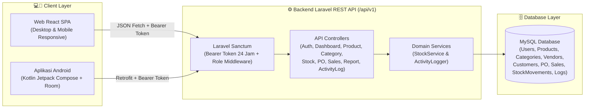
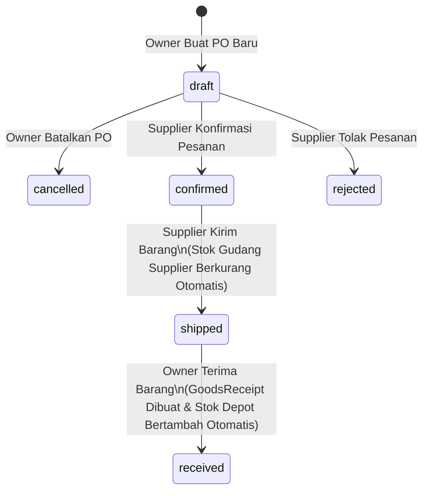
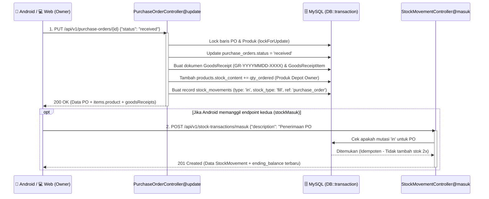

# 💧🔥 Depotify (Project WRZ) — Sistem Manajemen Inventori, Distribusi & Penjualan Depot Air Mineral & Gas LPG


**Depotify (`project_WRZ`)** adalah platform manajemen operasional depot air minum isi ulang (galon) dan gas LPG berbasis **Web (React Single Page Application)** dan **REST API (`/api/v1`)** yang terintegrasi penuh dengan aplikasi **Android**. Sistem ini menghubungkan **3 peran pengguna utama (Multi-Role)** dalam satu ekosistem *real-time*: **Owner/Admin Depot**, **Supplier (Vendor)**, dan **Pelanggan (Customer)**.

---

## 📌 Daftar Isi

1. [Gambaran Umum & Arsitektur Sistem](#1-gambaran-umum--arsitektur-sistem)
2. [Peran Pengguna (Multi-Role Access Control)](#2-peran-pengguna-multi-role-access-control)
3. [Penjelasan Lengkap Seluruh Fitur](#3-penjelasan-lengkap-seluruh-fitur)
   - [A. Fitur Publik & Autentikasi Terpadu](#a-fitur-publik--autentikasi-terpadu)
   - [B. Modul Owner / Admin Depot (9 Menu Utama)](#b-modul-owner--admin-depot-9-menu-utama)
   - [C. Modul Mitra Supplier / Vendor (7 Menu Utama)](#c-modul-mitra-supplier--vendor-7-menu-utama)
   - [D. Modul Pelanggan / Customer (4 Menu Utama)](#d-modul-pelanggan--customer-4-menu-utama)
4. [Logika Bisnis Utama (Core Business Logic)](#4-logika-bisnis-utama-core-business-logic)
5. [Struktur File & Direktori Proyek](#5-struktur-file--direktori-proyek)
6. [Struktur Tabel Database (Migrations & Models)](#6-struktur-tabel-database-migrations--models)
7. [Daftar Lengkap Endpoint REST API (`/api/v1`)](#7-daftar-lengkap-endpoint-rest-api-apiv1)
8. [Desain UI Neumorphic & Responsivitas Layar HP](#8-desain-ui-neumorphic--responsivitas-layar-hp)
9. [Panduan Instalasi, Menjalankan Lokal & Integrasi Android](#9-panduan-instalasi-menjalankan-lokal--integrasi-android)
10. [Dokumentasi Perbaikan & Output Fitur Direct Receive (Penerimaan Barang Mandiri PO)](#10-dokumentasi-perbaikan--output-fitur-direct-receive-penerimaan-barang-mandiri-po)

---

## 1. Gambaran Umum & Arsitektur Sistem

Depotify dirancang untuk menyelesaikan permasalahan operasional depot air galon dan gas LPG, mulai dari pencatatan stok isi vs wadah kosong, pengadaan stok ke supplier (Purchase Order), pemesanan pelanggan secara online maupun kasir, hingga pelaporan laba/rugi otomatis.



### Teknologi yang Digunakan (Tech Stack)
- **Backend Framework**: Laravel + PHP 8.2+
- **Autentikasi & Keamanan**: Laravel Sanctum (`Bearer Token` dengan masa aktif 24 jam), *Rate Limiting* (`throttle:15,1`), dan *Role-Based Middleware* (`EnsureUserRole`).
- **Frontend Web**: React 19, Vite, Custom Neumorphic CSS dengan dukungan penuh *Mobile Responsive* (`<= 820px`, `<= 768px`, `<= 480px`).
- **Database**: MySQL / MariaDB dengan transaksi atomik (`DB::transaction`) dan penguncian baris (`lockForUpdate()`) untuk mencegah *race condition* pada stok.

---

## 2. Peran Pengguna (Multi-Role Access Control)

Sistem menggunakan **1 Pintu Login Terpadu (`/api/v1/auth/login`)** yang secara otomatis mendeteksi peran (`role`) pengguna dan mengarahkannya ke ruang kerja (dashboard) masing-masing:

| Role | Nilai di Database | Hak Akses Utama |
| :--- | :--- | :--- |
| **Owner / Admin Depot** | `owner` | Mengelola seluruh operasional depot: dashboard analitik, produk depot, kategori, stok isi & kosong, manajemen akun supplier, pembuatan Purchase Order (PO), pemrosesan transaksi customer, laporan keuangan (cetak PDF), dan audit riwayat aktivitas akun. |
| **Supplier / Vendor** | `vendor` | Mengelola katalog produk pasokan milik supplier sendiri, kategori pasokan, stok gudang supplier, memproses PO yang masuk dari Owner (`Konfirmasi`, `Tolak`, `Kirim Barang`), melihat riwayat PO, dan memperbarui profil mitra. |
| **Pelanggan / Customer** | `customer` | Mendaftar akun secara mandiri, melihat katalog produk depot yang tersedia, memilih jenis pembelian (`Isi Ulang / Tukar Galon`, `Pinjam Wadah Baru + Deposit`, `Beli Putus`), berbelanja lewat Keranjang (*Cart*) atau Beli Langsung, memantau status pesanan, membatalkan pesanan yang masih diproses, dan mengatur profil/alamat pengiriman. |

---

## 3. Penjelasan Lengkap Seluruh Fitur

### A. Fitur Publik & Autentikasi Terpadu
1. **Landing Page Interaktif (`resources/js/app.jsx`)**:
   - Menampilkan informasi layanan Depotify, fitur unggulan (Kelola Stok, Transaksi, Laporan), alur kerja 3 langkah, dan tombol akses cepat menuju halaman Login.
2. **Login Satu Pintu (`resources/js/auth/login.jsx` & `Api\AuthController@login`)**:
   - Mendukung login untuk `owner`, `vendor`, dan `customer` dalam satu form.
   - Menghasilkan token Sanctum yang berlaku selama **24 jam** beserta pencatatan log login otomatis.
3. **Registrasi Mandiri Customer (`Api\AuthController@register`)**:
   - Pelanggan baru dapat langsung membuat akun dari tab **Daftar Akun** (Nama Lengkap, Email, No. Telepon, Alamat Pengiriman, Password & Konfirmasi).
   - Otomatis membuat data di tabel `users` (`role = 'customer'`) dan tabel `customers`, lalu langsung masuk ke dashboard pelanggan.
4. **Manajemen Sesi 24 Jam Otomatis (`resources/js/utils/session.js`)**:
   - Memverifikasi token ke `/api/v1/auth/me` saat aplikasi dibuka.
   - Memiliki *auto-logout timer* tepat saat sesi mencapai 24 jam serta sinkronisasi *logout* lintas *tab* browser.

---

### B. Modul Owner / Admin Depot (9 Menu Utama)

1. **Overview / Dashboard (`resources/js/admin/dashboard.jsx` & `Api\DashboardController@index`)**:
   - **4 Kartu KPI Hari Ini**: Transaksi Selesai Hari Ini, Pendapatan Hari Ini (`Rp`), Total Produk Aktif Depot, dan Jumlah Produk Stok Menipis.
   - **Grafik Penjualan 7 Hari Terakhir**: Grafik batang interaktif yang menampilkan tren omset harian selama 7 hari ke belakang.
   - **Panel Peringatan Stok Menipis**: Daftar 10 produk depot yang stok isinya berada di bawah atau sama dengan batas minimum (`stock_content <= minimum_stock`).
   - **Panel Produk Terlaris 7 Hari**: 5 produk dengan kuantitas penjualan tertinggi dalam seminggu terakhir.
   - **Panel Transaksi Terbaru**: 10 transaksi penjualan terbaru beserta statusnya.

2. **Manajemen Produk Depot (`resources/js/admin/product.jsx` & `ProductController`)**:
   - **CRUD Produk Depot (`vendor_id = NULL`)**: Tambah, lihat, edit, dan hapus produk yang dijual depot ke pelanggan.
   - **Atribut Produk Lengkap**: Nama produk, SKU unik, Kategori, Varian (misal `19 L`, `3 Kg`), Satuan (`gallon`, `canister`, `pcs`, `other`), Harga Jual (`selling_price`), Harga Deposit Wadah (`deposit_price`), Harga Modal Beli (`purchase_price`), Minimum Stok (`minimum_stock`), dan Status Aktif (`is_active`).
   - **Proteksi Penghapusan**: Produk yang sudah memiliki riwayat transaksi atau mutasi stok tidak dapat dihapus sembarangan demi menjaga integritas laporan keuangan (disarankan untuk dinonaktifkan).
   - **Pencarian & Filter**: Cari berdasarkan nama/SKU dan filter per kategori.

3. **Manajemen Kategori Depot (`resources/js/admin/category.jsx` & `CategoryController`)**:
   - **CRUD Kategori (`vendor_id = NULL`)**: Mengelola kode kategori (misal `LPG`, `AIR`), nama kategori, dan deskripsi.
   - **Proteksi Relasi**: Kategori yang masih digunakan oleh produk tidak bisa dihapus sebelum produknya dipindahkan/dihapus (HTTP 409).

4. **Pemantauan Stok Depot (`resources/js/admin/stock.jsx` & `StockController`)**:
   - **4 Kartu Ringkasan Stok**: Total Produk, Total Stok Isi (`stock_content`), Total Stok Wadah Kosong (`empty_stock`), dan Stok Perlu Perhatian (`menipis` / `habis`).
   - **Tabel Status Stok Real-Time**: Menampilkan stok isi, stok galon/tabung kosong, batas minimum, dan *badge* indikator otomatis:
     - **Aman** (Hijau): `stock_content > minimum_stock`
     - **Menipis** (Kuning/Oranye): `0 < stock_content <= minimum_stock`
     - **Habis** (Merah): `stock_content <= 0`

5. **Pembelian / Purchase Order ke Supplier (`resources/js/admin/purchase.jsx` & `PurchaseOrderController`)**:
   - **4 Kartu Ringkasan PO**: Total PO, Sedang Diproses, Selesai (Diterima), dan Total Nilai Pembelian.
   - **Pembuatan PO Multi-Item**:
     - Saat Owner memilih Supplier tujuan, daftar pilihan produk otomatis menampilkan **katalog produk milik Supplier tersebut** beserta harga pasokannya.
     - Mendukung metode pembayaran (`Tunai`, `Transfer Bank`, `QRIS`, `Tempo / Utang`), alamat pengiriman, catatan, dan kalkulasi subtotal otomatis.
   - **Alur Status PO di Sisi Owner**:
     - Saat status masih `draft`/`ordered` (Pending): Owner dapat menekan **Batalkan PO (`cancelled`)**.
     - Saat Supplier sudah mengirim barang (`shipped`): Owner dapat menekan **Terima Barang (`received`)** yang secara otomatis menambah stok produk di gudang Depot Owner!

6. **Riwayat Transaksi Pelanggan (`resources/js/admin/transactions.jsx` & `SalesTransactionController`)**:
   - **4 Kartu Ringkasan**: Total Transaksi, Selesai (`completed`), Diproses (`processing`), dan Dibatalkan (`cancelled`).
   - **Manajemen Pesanan Masuk**: Memantau pesanan yang masuk dari aplikasi Customer, melihat rincian item & jenis pembelian wadah, serta mengubah status pesanan:
     - **Tandai Selesai (`completed`)**: Pesanan telah diterima pelanggan dan pembayaran lunas (masuk ke perhitungan Pemasukan di Laporan).
     - **Batalkan Pesanan (`cancelled`)**: Membatalkan pesanan dan **otomatis mengembalikan stok isi serta menarik kembali hitungan wadah kosong** di gudang depot.

7. **Manajemen Supplier & Akun Mitra (`resources/js/admin/vendor.jsx` & `VendorController`)**:
   - **CRUD Supplier + Pembuatan Akun Login Otomatis**: Saat Owner menambahkan Supplier baru (Nama Perusahaan, Telepon, Alamat, Email Login, Password), sistem otomatis membuatkan akun `User` dengan `role = 'vendor'` sehingga mitra supplier tersebut langsung dapat login ke Portal Supplier.
   - **Proteksi Data**: Supplier yang sudah memiliki riwayat Purchase Order tidak dapat dihapus agar riwayat pengadaan tetap utuh.

8. **Laporan Keuangan, Penjualan & Export PDF (`resources/js/admin/reports.jsx` & `ReportController`)**:
   - **Filter Periode Fleksibel**: `Semua Waktu`, `Hari Ini`, `7 Hari Terakhir`, `Bulan Ini`, dan `Pilih Tanggal Kustom (Start Date - End Date)`.
   - **5 Kartu Keuangan Utama**:
     1. **Pemasukan**: Akumulasi transaksi penjualan customer yang berstatus `completed`.
     2. **Pengeluaran**: Akumulasi belanja PO ke supplier yang berstatus `received`.
     3. **Laba Bersih (`Net Profit`)**: Selisih positif antara pemasukan dan pengeluaran.
     4. **Rugi (`Net Loss`)**: Selisih negatif jika pengeluaran pengadaan melebihi pemasukan pada periode tersebut.
     5. **Saldo Bersih (`Net Balance`)**: Posisi kas bersih (`Pemasukan - Pengeluaran`).
   - **Analisis Performa Produk**:
     - Tabel **Barang Paling Laku (Terlaris)** berdasarkan unit terjual dan total pendapatan.
     - Tabel **Barang Jarang Dibeli** untuk membantu Owner mengevaluasi stok yang lambat berputar (*slow-moving stock*).
   - **Tabel Arus Kas (Tab Pemasukan & Pengeluaran)** dengan fitur *pagination*.
   - **Export / Convert PDF Siap Cetak**: Menghasilkan dokumen laporan resmi ukuran A4 lengkap dengan kop Depotify, ringkasan 5 metrik keuangan, tabel produk terlaris & jarang dibeli, tabel rincian pemasukan & pengeluaran, serta kolom tanda tangan Owner.

9. **Riwayat Aktivitas & Sesi Akun (`resources/js/admin/activity-history.jsx` & `ActivityLogController`)**:
   - **4 Kartu Ringkasan Audit**: Total Aktivitas Tercatat, Aktivitas Login/Auth, Aktivitas Transaksi & Stok, serta Sesi Aktif (24 Jam).
   - **Tabel Sesi Login Aktif & Terakhir**: Memantau siapa saja (`Owner`, `Supplier`, `Customer`) yang sedang memiliki token sesi aktif beserta waktu login, aktivitas terakhir, dan waktu kedaluwarsa.
   - **Tabel Log Aktivitas Sistem**: Mencatat jejak waktu, nama pengguna, email, role, jenis aksi (`login`, `logout`, `register`, `create`, `update`, `delete`, `status_change`), modul, rincian aktivitas, dan alamat IP.

---

### C. Modul Mitra Supplier / Vendor (7 Menu Utama)

Diakses ketika pengguna login menggunakan akun ber-role `vendor` (`resources/js/vendor/dashboard.jsx`):

1. **Overview Supplier**:
   - Menampilkan 4 kartu metrik PO untuk supplier tersebut: `Pesanan Diterima`, `Menunggu Konfirmasi`, `Sedang Diproses`, dan `Pesanan Selesai`, serta tabel 8 pesanan terbaru dari Depot Owner.
2. **Produk Supplier (`resources/js/vendor/product.jsx`)**:
   - Supplier mengelola katalog produk pasokannya sendiri (`vendor_id = ID Supplier`), menentukan harga jual ke depot, satuan, varian, dan batas minimum stok gudang supplier.
3. **Kategori Supplier (`resources/js/vendor/category.jsx`)**:
   - Supplier mengelola kategori barang pasokannya sendiri tanpa bercampur dengan kategori internal milik Depot Owner.
4. **Stok Gudang Supplier (`resources/js/vendor/stock.jsx`)**:
   - Memantau jumlah stok gudang milik supplier dan dilengkapi modal **Atur Stok** (`PUT /api/v1/stock/{id}`) untuk memperbarui jumlah stok isi, stok wadah kosong, dan batas minimum stok gudang supplier.
5. **Pesanan PO Masuk (`resources/js/vendor/orders.jsx` & `order-detail-modal.jsx`)**:
   - Melihat detail pesanan dari Depot Owner dan menjalankan aksi perubahan status PO:
     - **Konfirmasi Pesanan (`confirmed`)** atau **Tolak Pesanan (`rejected`)** saat PO baru masuk (`draft`/`ordered`).
     - **Tandai Dikirim (`shipped`)** saat barang dikirim ke depot — otomatis memotong stok gudang milik Supplier!
6. **Riwayat PO Supplier (`resources/js/vendor/history.jsx`)**:
   - Menampilkan arsip pesanan yang sudah dikirim (`shipped`), selesai diterima depot (`received`), ditolak (`rejected`), atau dibatalkan (`cancelled`).
7. **Profil Mitra (`resources/js/vendor/profile.jsx`)**:
   - Mengubah nama perusahaan supplier, nomor telepon, alamat gudang, email login, dan kata sandi.

---

### D. Modul Pelanggan / Customer (4 Menu Utama)

Diakses ketika pengguna login atau mendaftar sebagai `customer` (`resources/js/customer/dashboard.jsx`):

1. **Katalog & Beli**:
   - Menampilkan 4 kartu ringkasan pelanggan (`Produk Tersedia`, `Isi Keranjang`, `Pesanan Diproses`, `Pesanan Selesai`).
   - Menampilkan daftar produk depot beserta harga isi ulang, informasi biaya deposit wadah baru (jika produk menggunakan galon/tabung), sisa stok tersedia, tombol **+ Keranjang**, dan tombol **Beli Sekarang** (checkout instan 1 produk).
2. **Keranjang Belanja (*Shopping Cart*)**:
   - Mengatur kuantitas pembelian per produk (dibatasi maksimal sejumlah stok yang tersedia di depot).
   - Memilih **Jenis Pembelian (`transaction_type`)** untuk produk berwadah (galon/tabung gas):
     - **Isi Ulang (`top_up`)**: Pelanggan menukar wadah kosong miliknya (hanya membayar harga isi ulang).
     - **Pinjam Wadah Baru (`new_deposit`)**: Pelanggan belum punya galon/tabung kosong (membayar `selling_price + deposit_price`).
     - **Beli Putus (`buy_disconnect`)**: Pembelian tanpa pertukaran wadah.
   - Memilih metode pembayaran (`Tunai / COD`, `Transfer Bank`, `QRIS`) serta mengisi nomor telepon dan alamat pengiriman.
3. **Pesanan Saya**:
   - Memantau status pesanan secara langsung (`Diproses`, `Selesai`, `Dibatalkan`), melihat rincian nota pesanan, serta tombol **Batalkan Pesanan** jika pesanan masih berstatus `processing`.
4. **Profil Saya**:
   - Memperbarui nama lengkap, email, nomor telepon, alamat pengiriman default, dan kata sandi.

---

## 4. Logika Bisnis Utama (Core Business Logic)

### 1. Siklus Hidup Purchase Order (Owner $\leftrightarrow$ Supplier) & Sinkronisasi Stok Otomatis

- **Pemotongan Stok Supplier Saat `shipped` (`PurchaseOrderController::deductSupplierStockOnShip`)**:
  Saat Supplier menekan tombol *Tandai Dikirim*, sistem mengunci baris produk supplier (`lockForUpdate()`), memastikan stok gudang supplier mencukupi, mengurangi `stock_content` supplier, dan mencatat kartu stok `po_supplier_out` (dijamin idempoten / hanya terpotong 1 kali).
- **Penambahan Stok Depot & Sinkronisasi Produk Saat `received` (`PurchaseOrderController::receiveOrderItemsIntoStock`)**:
  Saat Owner menekan tombol *Terima Barang*, sistem otomatis membuat dokumen `GoodsReceipt` (`GR-YYYYMMDD-XXXX`), mencari produk padanan di gudang Depot Owner (`vendor_id = NULL`) berdasarkan `source_product_id` atau nama+varian (dan jika belum ada di gudang depot, **otomatis membuatkan produk & kategori padanannya**), lalu menambah `stock_content` depot dan mencatat `StockMovement` (`goods_receipt`).

### 2. Logika Wadah Galon/Tabung Gas & Pengembalian Stok (*Rollback*) pada Penjualan Customer
- **Saat Checkout (`SalesTransactionController@store`)**:
  - `stock_content` (stok isi) produk depot langsung dikurangi sebesar `qty` melalui `StockService::keluar()`.
  - Jika tipe pembelian adalah `top_up` (Isi Ulang / Tukar Galon), maka `empty_stock` (stok galon/tabung kosong di depot) otomatis bertambah sebesar `empty_container_accepted` melalui `StockService::masuk()`.
- **Saat Pesanan Dibatalkan (`SalesTransactionController@update`)**:
  - Jika pesanan dibatalkan (`status = 'cancelled'`) baik oleh Customer maupun Owner, sistem secara otomatis mengembalikan `stock_content` yang sudah terpotong dan menarik kembali `empty_stock` wadah kosong agar saldo stok fisik tetap 100% akurat.

---

## 5. Struktur File & Direktori Proyek

```text
project_WRZ/
├── app/
│   ├── Http/
│   │   ├── Controllers/
│   │   │   ├── Api/
│   │   │   │   ├── AuthController.php          # Login, Register Customer, Me, Logout, Update Profil Customer
│   │   │   │   └── DashboardController.php     # Agregasi KPI Dashboard Owner, Supplier, dan Customer
│   │   │   ├── ActivityLogController.php       # Riwayat aktivitas akun & sesi login Sanctum
│   │   │   ├── CategoryController.php          # CRUD Kategori (terisolasi untuk Owner & Supplier)
│   │   │   ├── ProductController.php           # CRUD Produk (terisolasi untuk Owner & Supplier)
│   │   │   ├── PurchaseOrderController.php     # Siklus PO & sinkronisasi stok Supplier -> Depot Owner
│   │   │   ├── ReportController.php            # Kalkulasi laporan keuangan, HPP, laba/rugi & performa produk
│   │   │   ├── SalesTransactionController.php  # Checkout customer, manajemen transaksi & rollback stok
│   │   │   ├── StockController.php             # Monitoring & penyesuaian stok isi/kosong
│   │   │   └── Vendorcontroller.php            # CRUD Supplier + pembuatan akun login vendor otomatis
│   │   └── Middleware/
│   │       └── EnsureUserRole.php              # Proteksi hak akses berbasis role & status aktif akun
│   ├── Models/                                 # Eloquent Models (User, Product, Category, Vendor, Customer, dll.)
│   └── Services/
│       ├── ActivityLogger.php                  # Pencatatan audit log aman (fail-safe)
│       └── StockService.php                    # Mutasi stok masuk/keluar dengan DB Transaction & Row Locking
├── database/
│   ├── migrations/                             # Skema tabel database MySQL
│   └── seeders/                                # Data awal (Owner, Supplier, Customer, Kategori, Produk)
├── resources/
│   ├── css/                                    # 10 stylesheet Neumorphic + Media Queries Mobile Responsive
│   ├── js/
│   │   ├── admin/                              # 9 komponen halaman Owner (dashboard, product, category, stock, purchase, transactions, vendor, reports, activity-history)
│   │   ├── auth/login.jsx                      # Halaman Login multi-role & Registrasi Customer
│   │   ├── components/sidebar.jsx              # Navigasi sidebar Owner (responsif di layar HP)
│   │   ├── customer/dashboard.jsx              # Portal belanja Customer (Katalog, Keranjang, Pesanan, Profil)
│   │   ├── utils/session.js                    # Manajemen token Sanctum, validasi sesi & timer 24 jam
│   │   ├── vendor/                             # 8 file modul Portal Supplier
│   │   └── app.jsx                             # Root aplikasi React SPA & Landing Page
│   └── views/
│       └── app.blade.php                       # Entry point HTML untuk React SPA
└── routes/
    ├── api.php                                 # Seluruh endpoint REST API (/api/v1/*)
    └── web.php                                 # Rute masuk utama React SPA
```

---

## 6. Struktur Tabel Database (Migrations & Models)

| Nama Tabel | Model | Fungsi Utama |
| :--- | :--- | :--- |
| `users` | `User` | Menyimpan akun login seluruh pengguna (`owner`, `vendor`, `customer`), password terenkripsi, dan status `is_active`. |
| `personal_access_tokens` | *(Sanctum)* | Menyimpan token Bearer autentikasi API dengan masa berlaku 24 jam. |
| `vendor` | `Vendor` | Profil perusahaan Supplier yang terhubung ke `users.id` (`user_id`). |
| `customers` | `Customer` | Profil pelanggan beserta nomor telepon dan alamat pengiriman yang terhubung ke `users.id`. |
| `categories` | `Category` | Master kategori produk (`vendor_id = NULL` untuk Depot Owner, `vendor_id = X` untuk Supplier). |
| `vendor_category` | *(Pivot)* | Tabel penghubung *many-to-many* antara Supplier dan Kategori. |
| `products` | `Product` | Data produk, harga jual, harga deposit wadah, harga beli, `stock_content` (stok isi), `empty_stock` (stok kosong), dan `minimum_stock`. |
| `purchase_orders` | `PurchaseOrder` | Header pesanan pembelian stok dari Owner ke Supplier (`po_number`, `status`, `payment_method`, `total_price`). |
| `purchase_order_items` | `PurchaseOrderItem` | Rincian barang dan kuantitas yang dipesan di dalam setiap PO. |
| `goods_receipts` | `GoodsReceipt` | Bukti penerimaan barang (`GR-...`) saat PO diterima oleh Depot Owner. |
| `goods_receipt_items` | `GoodsReceiptItem` | Rincian kuantitas barang yang diterima (`qty_diterima`) dan ditolak (`qty_ditolak`) per item PO. |
| `sales_transactions` | `SalesTransaction` | Header transaksi penjualan ke pelanggan (`SALE-...`, `total_amount`, `payment_method`, `status`). |
| `sales_transaction_items` | `SalesTransactionItem` | Rincian item yang dibeli pelanggan beserta tipe wadah (`top_up`, `new_deposit`, `buy_disconnect`). |
| `stock_movements` | `StockMovement` | Buku besar / kartu stok yang mencatat setiap mutasi masuk (`in`), keluar (`out`), dan penyesuaian (`adjustment`) beserta saldo akhirnya (`ending_balance`). |
| `activity_logs` | `ActivityLog` | Jejak audit seluruh aktivitas login, registrasi, pembuatan/perubahan transaksi, dan perubahan stok di sistem. |

---

## 7. Daftar Lengkap Endpoint REST API (`/api/v1`)

Seluruh endpoint di bawah menggunakan prefix `/api/v1` dan mengembalikan format JSON. Untuk endpoint yang memerlukan autentikasi, sertakan header `Authorization: Bearer <token>`.

### A. Autentikasi & Kesehatan Server
| Method | Endpoint | Hak Akses | Deskripsi |
| :--- | :--- | :--- | :--- |
| `GET` | `/api/health` & `/api/v1/health` | Publik | Cek status aktif server Laravel. |
| `POST` | `/api/v1/auth/login` | Publik | Login terpadu untuk `owner`, `vendor`, dan `customer`. |
| `POST` | `/api/v1/auth/register` | Publik | Registrasi akun baru khusus `customer`. |
| `GET` | `/api/v1/auth/me` | Semua Role (`auth:sanctum`) | Ambil data user yang sedang login beserta profil `vendor`/`customer`. |
| `POST` | `/api/v1/auth/logout` | Semua Role (`auth:sanctum`) | Hapus token sesi aktif dan catat log logout. |

### B. Endpoint Khusus Owner (`role:owner`)
| Method | Endpoint | Deskripsi |
| :--- | :--- | :--- |
| `GET` | `/api/v1/dashboard` | Ambil metrik KPI harian, grafik 7 hari, stok menipis, produk terlaris, dan transaksi terbaru. |
| `POST` | `/api/v1/purchase-orders` | Buat Purchase Order (PO) baru ke Supplier. |
| `DELETE` | `/api/v1/purchase-orders/{id}` | Hapus PO yang masih berstatus `draft`. |
| `GET` | `/api/v1/sales` | Daftar seluruh transaksi penjualan pelanggan beserta ringkasan metrik. |
| `GET` | `/api/v1/sales/{id}` | Detail satu transaksi penjualan. |
| `POST` | `/api/v1/sales` | Buat transaksi penjualan baru (Kasir / Walk-in). |
| `PUT` | `/api/v1/sales/{id}` | Ubah status transaksi (`completed` atau `cancelled` dengan pengembalian stok otomatis). |
| `DELETE` | `/api/v1/sales/{id}` | Batalkan transaksi penjualan dan kembalikan stok. |
| `GET` | `/api/v1/vendors` | Daftar seluruh Supplier (`POST`, `PUT /{id}`, `DELETE /{id}` untuk tambah/edit/hapus supplier & akun loginnya). |
| `GET` | `/api/v1/reports` | Ambil laporan keuangan (Pemasukan, Pengeluaran, HPP, Laba/Rugi, Produk Terlaris & Jarang Laku). |
| `GET` | `/api/v1/activity-logs` | Ambil daftar sesi aktif dan riwayat aktivitas seluruh akun. |

### C. Endpoint Kolaborasi Owner & Supplier (`role:owner,vendor`)
*(Data otomatis difilter oleh Controller berdasarkan siapa yang login)*
| Method | Endpoint | Deskripsi |
| :--- | :--- | :--- |
| `GET` | `/api/v1/categories` | Daftar kategori (`POST`, `PUT /{id}`, `DELETE /{id}` untuk kelola kategori). |
| `GET` | `/api/v1/products` | Daftar produk (`POST`, `PUT /{id}`, `DELETE /{id}` untuk kelola produk). |
| `GET` | `/api/v1/stock` | Daftar status stok isi & kosong (`GET /{id}` untuk detail, `PUT /{id}` untuk atur stok). |
| `POST` | `/api/v1/stock-transactions/masuk` | Catat transaksi stok masuk (`in`) untuk stok isi (`fill`) atau kosong (`empty`). |
| `POST` | `/api/v1/stock-transactions/keluar` | Catat transaksi stok keluar (`out`) untuk stok isi (`fill`) atau kosong (`empty`). |
| `POST` | `/api/v1/stock-transactions/penyesuaian` | Catat penyesuaian stok fisik / *stock opname* (`adjustment`). |
| `GET` | `/api/v1/stock-movements` | Daftar riwayat pergerakan stok (`POST` untuk tambah manual, `GET /{id}` untuk detail). |
| `GET` | `/api/v1/purchase-orders` | Daftar PO (`GET /{id}` untuk detail, `PUT /{id}` untuk ubah status PO / *Direct Receive*). |
| `GET` | `/api/v1/goods-receipts` | Daftar dokumen penerimaan barang PO (`POST` untuk buat Goods Receipt & tambah stok, `GET /{id}` detail). |
| `GET` | `/api/v1/stock-notifications` | Daftar notifikasi peringatan stok menipis (`PATCH /{id}/read` tandai dibaca, `DELETE /{id}` hapus). |

### D. Endpoint Khusus Supplier (`role:vendor`)
| Method | Endpoint | Deskripsi |
| :--- | :--- | :--- |
| `GET` | `/api/v1/supplier/dashboard` | Ringkasan metrik PO dan daftar pesanan terbaru khusus Supplier yang login. |
| `GET` | `/api/v1/supplier/profile` | Ambil profil perusahaan & akun Supplier. |
| `PUT` | `/api/v1/supplier/profile` | Perbarui profil perusahaan, email, atau password Supplier. |

### E. Endpoint Khusus Pelanggan (`role:customer`)
| Method | Endpoint | Deskripsi |
| :--- | :--- | :--- |
| `GET` | `/api/v1/customer/dashboard` | Ambil katalog produk aktif depot beserta ketersediaan stok. |
| `PUT` | `/api/v1/customer/profile` | Perbarui nama, email, telepon, alamat pengiriman, atau password pelanggan. |
| `GET` | `/api/v1/customer/orders` | Daftar riwayat pesanan milik pelanggan yang sedang login. |
| `GET` | `/api/v1/customer/orders/{id}` | Detail nota pesanan pelanggan. |
| `POST` | `/api/v1/customer/orders` | Buat pesanan baru (dari Keranjang maupun Beli Sekarang). |
| `PUT` | `/api/v1/customer/orders/{id}` | Batalkan pesanan (`status: "cancelled"`) selama pesanan masih diproses. |

---

## 8. Desain UI Neumorphic & Responsivitas Layar HP

Seluruh antarmuka web di `resources/css/` menggunakan gaya visual **Soft Neumorphic UI** yang telah dioptimalkan agar **100% responsif saat dibuka di layar handphone (Mobile Browser)**:
- **Navigasi Sidebar Adaptif (`<= 820px`)**: Pada layar HP, *sidebar* Owner, Supplier, dan Customer otomatis berubah menjadi bar profil horizontal ringkas dengan deretan menu *pill* yang dapat digeser ke kiri-kanan (*horizontal touch scroll*), sehingga tidak menutupi isi halaman utama.
- **Grid Kartu & Grafik Fleksibel**: Kartu ringkasan 4–5 kolom otomatis menyesuaikan menjadi 2 kolom di tablet dan 1 kolom penuh di layar HP (`<= 560px` / `<= 480px`), sementara grafik penjualan 7 hari mendukung *horizontal scroll* agar label nominal tidak bertumpuk.
- **Tabel & Modal Ramah Layar Sentuh**: Semua tabel data dilengkapi pembungkus *smooth horizontal scroll* (`-webkit-overflow-scrolling: touch`) dengan `min-width` terjaga, dan seluruh *modal pop-up* menyesuaikan tinggi layar HP (`100dvh`) dengan form 1 kolom yang nyaman diisi di ponsel.

---

## 9. Panduan Instalasi, Menjalankan Lokal & Integrasi Android

### 1. Persiapan & Instalasi Proyek Web / Backend
Pastikan **PHP 8.2+**, **Composer**, **Node.js & NPM**, serta **MySQL (XAMPP)** sudah aktif, lalu jalankan perintah berikut di terminal pada folder proyek:

```bash
# 1. Instal dependensi PHP & JavaScript
composer install
npm install

# 2. Salin konfigurasi environment & buat application key
cp .env.example .env
php artisan key:generate

# 3. Jalankan migrasi tabel & seeder data awal
php artisan migrate --seed

# 4. Build aset frontend produksi (Vite)
npm run build
```

### 2. Menjalankan Server untuk Akses Web & Aplikasi Android (Wi-Fi / Hotspot LAN)
Agar server Laravel dapat diakses sekaligus oleh browser laptop dan aplikasi **Android** di jaringan Wi-Fi/Hotspot yang sama:

1. **Buka Izin Port 8000 di Windows Firewall** *(cukup dijalankan 1 kali di PowerShell sebagai Administrator)*:
   ```powershell
   New-NetFirewallRule -DisplayName "Laravel Port 8000" -Direction Inbound -LocalPort 8000 -Protocol TCP -Action Allow -Profile Any
   ```
2. **Jalankan Server Laravel pada Host `0.0.0.0`**:
   ```bash
   php artisan serve --host=0.0.0.0 --port=8000
   ```
3. **Konfigurasi `BASE_URL` di Project Android (`app/build.gradle.kts`)**:
   - Saat menggunakan **Wi-Fi / Hotspot Lokal**: arahkan `BASE_URL` ke IPv4 laptop kamu (cek dengan `ipconfig`, misalnya `"http://10.40.45.215:8000/api/"`).
   - Saat menggunakan **Emulator Android Studio**: arahkan ke `"http://10.0.2.2:8000/api/"`.
   - Saat **Sudah Di-Hosting**: arahkan ke domain hosting asli kamu (misalnya `"https://domain-depotify-kamu.com/api/"`).

---

## 10. Dokumentasi Perbaikan & Output Fitur Direct Receive (Penerimaan Barang Mandiri PO)

Bagian ini mendokumentasikan analisis kondisi masalah, perbaikan arsitektur backend, serta hasil/output sistem pada fitur **Direct Receive (Konfirmasi Penerimaan Barang Mandiri oleh Admin/Owner Depot tanpa menunggu konfirmasi Supplier)** antara aplikasi **Android (`Depotify_WRZ`)** dan **Server Database / Website**.

### 10.1 Perbandingan Kondisi Sebelum vs Sesudah Perbaikan

| Aspek | ❌ Kondisi Sebelum Perbaikan (*Before*) | ✅ Kondisi Sesudah Perbaikan (*After*) |
| :--- | :--- | :--- |
| **Transisi Status PO (*State Machine*)** | `OWNER_TRANSITIONS` di `PurchaseOrderController` hanya mengizinkan `draft/ordered -> cancelled` dan `shipped -> received`. Saat Admin melakukan *Direct Receive* dari status `draft`/`ordered`/`confirmed`, server menolak dengan **HTTP 422**. | `OWNER_TRANSITIONS` mengizinkan Owner melakukan *Direct Receive* dari status `draft`, `ordered`, `confirmed`, maupun `shipped` langsung ke `received` (dan bersifat idempoten jika dikirim ulang). |
| **Ketergantungan Stok Gudang Supplier** | `deductSupplierStockOnShip()` melempar **HTTP 422 (`ValidationException`)** jika stok produk di gudang Supplier masih `0`, sehingga menggagalkan penambahan stok di gudang Depot Owner. | Mode *non-strict* diterapkan saat Owner melakukan *Direct Receive*: jika stok gudang Supplier `0`, proses tidak gagal dan langsung melanjutkan penambahan stok ke gudang Depot Owner. |
| **Endpoint Mutasi Stok & Goods Receipt Android** | Route `/api/v1/stock-transactions/masuk` dan `/api/v1/goods-receipts` belum terdaftar di `routes/api.php` (**HTTP 404**), sehingga stok hanya bertambah sementara di *cache* lokal HP. | Seluruh route `/stock-transactions/*`, `/stock-movements`, dan `/goods-receipts` telah terdaftar dan terhubung ke `StockMovementController` & `GoodsReceiptController` dalam `DB::transaction`. |
| **Proteksi Anti *Double-Increment*** | Berpotensi menambah stok 2 kali lipat karena Android memanggil `PUT /purchase-orders/{id}` (`received`) diikuti `POST /stock-transactions/masuk` (`Penerimaan PO #...`). | `StockMovementController@store` mendeteksi referensi `PO #{id}` yang sudah dicatat oleh `PurchaseOrderController` dan mengembalikan data mutasi yang ada tanpa menggandakan stok. |
| **Kondisi Setelah Refresh / Sync Ulang** | Karena database MySQL server tidak berubah (tetap `0`) dan `PUT /products/{id}` dari Android mengirim default `stock_content: 0`, saat layar Android di-*refresh*, stok kembali menjadi **0**. | Stok produk di tabel `products` (`stock_content`) bertambah permanen di database MySQL, tercatat di `goods_receipts` & `stock_movements`, serta tetap konsisten di Android maupun Website meskipun di-*refresh* berkali-kali. |

---

### 10.2 Alur Eksekusi Direct Receive di Backend (Setelah Perbaikan)



---

### 10.3 Hasil & Output Sistem Setelah Perbaikan

#### 1. Output JSON `PUT /api/v1/purchase-orders/{id}` (Direct Receive)
**Request:**
```http
PUT /api/v1/purchase-orders/12
Authorization: Bearer <token_owner>
Content-Type: application/json

{
  "status": "received",
  "notes": "Bypass Admin - Konfirmasi Diterima Langsung"
}
```

**Response (`200 OK`):**
```json
{
  "id": 12,
  "po_number": "PO-20261118-0001",
  "po_date": "2026-11-18T00:00:00.000000Z",
  "vendor_id": 1,
  "payment_method": "cash",
  "subtotal_price": "180000.00",
  "total_price": "180000.00",
  "status": "received",
  "notes": "Bypass Admin - Konfirmasi Diterima Langsung",
  "items": [
    {
      "id": 15,
      "purchase_order_id": 12,
      "product_id": 1,
      "product_name": "Aqua (19 L)",
      "qty_ordered": 10,
      "agreed_price": "18000.00",
      "total_price": "180000.00",
      "product": {
        "id": 1,
        "name": "Aqua",
        "variant": "19 L",
        "stock_content": 10,
        "empty_stock": 0
      }
    }
  ],
  "goods_receipts": [
    {
      "id": 4,
      "purchase_order_id": 12,
      "receipt_number": "GR-20261118-0001",
      "qc_status": "passed",
      "document_type": "do_and_invoice",
      "document_number": "PO-20261118-0001"
    }
  ]
}
```

#### 2. Output JSON `POST /api/v1/stock-transactions/masuk`
**Request:**
```http
POST /api/v1/stock-transactions/masuk
Authorization: Bearer <token_owner>
Content-Type: application/json

{
  "product_id": 1,
  "stock_type": "fill",
  "movement_type": "in",
  "qty": 10,
  "description": "Penerimaan PO #12 (Bypass Admin)"
}
```

**Response (`201 Created`):**
```json
{
  "success": true,
  "message": "Transaksi pergerakan stok berhasil disimpan.",
  "data": {
    "id": 28,
    "product_id": 1,
    "stock_type": "fill",
    "movement_type": "in",
    "qty": 10,
    "ending_balance": 10,
    "reference_type": "purchase_order",
    "reference_id": 12,
    "description": "Penerimaan PO PO-20261118-0001 (GR-20261118-0001)",
    "created_by": 1,
    "product": {
      "id": 1,
      "name": "Aqua",
      "stock_content": 10,
      "empty_stock": 0
    }
  }
}
```

#### 3. Kondisi Tabel Database MySQL Setelah Direct Receive (`qty_ordered = 10`)
1. **Tabel `purchase_orders`**:
   - Kolom `status` berubah menjadi `'received'`.
2. **Tabel `goods_receipts` & `goods_receipt_items`**:
   - Terbuat record baru `GR-YYYYMMDD-XXXX` dengan `qc_status = 'passed'` dan `qty_diterima = 10`.
3. **Tabel `products` (Milik Depot Owner / `vendor_id = NULL`)**:
   - Kolom `stock_content` bertambah secara permanen (`0 + 10 = 10`).
   - Kolom `purchase_price` diperbarui sesuai `agreed_price` PO.
4. **Tabel `stock_movements`**:
   - Terbuat 1 baris kartu stok dengan `stock_type = 'fill'`, `movement_type = 'in'`, `qty = 10`, `ending_balance = 10`, `reference_type = 'purchase_order'`, dan `reference_id = 12`.
5. **Tabel `activity_logs`**:
   - Tercatat log audit perubahan status PO menjadi *"Selesai (Barang Diterima & Stok Bertambah)"*.

---

## 📄 Lisensi

Hak Cipta © 2026 **Depotify (Project WRZ)**. Dikembangkan dengan Laravel & React.
